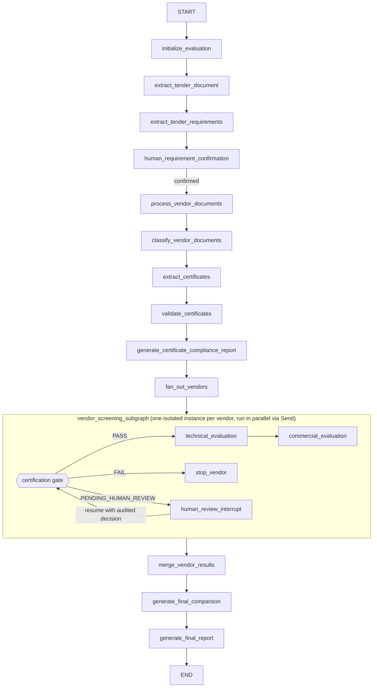

# LangGraph Workflow

Two stages of graph, deliberately separated so that downstream evaluation can never be reached
without a recorded certification result.

## Rules enforced by structure (not by prompts)
1. `generate_certificate_compliance_report` is a hard predecessor of `fan_out_vendors`; the Excel
   certification workbook exists before any technical/commercial node can run.
2. Fan-out uses `Send` with a **per-vendor input** containing only that vendor's documents, so
   a vendor subgraph cannot read another vendor's data.
3. Per-vendor results are written to dict fields with a merge reducer keyed by `vendor_id`; a
   reducer rejects overwriting an existing key with a conflicting value.
4. `technical_evaluation` and `commercial_evaluation` are only reachable via the `PASS` branch,
   and each re-asserts `eligibility == PASS` on entry (defence in depth; raises if violated).
5. `PENDING_HUMAN_REVIEW` uses LangGraph `interrupt()` with a persistent checkpointer; resume
   requires an audited decision. Pending is never coerced to PASS.
6. Technical/commercial ordering follows configurable tender rules; both are after PASS.
7. Every node records start/end/status/error in `node_executions` for progress and audit.

## As implemented (Phase 8) - `backend/app/graph/`
Generated diagram: [workflow.mmd](workflow.mmd). Differences from the design above, and why:
* The graph starts at `load_context`; tender upload/extraction and requirement confirmation stay as API steps with their
  own human gate (the graph refuses to start unless requirements are confirmed and >= 1 vendor exists).
* Two fan-outs via `Send`: `screen_vendor` (parallel, one isolated subgraph per vendor: `verify_documents` ->
  `screen_certificates`) and, after the report, `vendor_downstream` (`technical_evaluation` -> `commercial_evaluation`)
  only for vendors whose recorded eligibility is PASS and that have not been evaluated yet.
* Branch output schema exposes only reducer-backed keys (`vendor_results`, `downstream_done`, `node_log`, `errors`), so
  parallel branches cannot collide. `merge_vendor_results` raises `StateConflictError` if a technical/commercial result is
  ever overwritten with a different value; `screening` may change (after human review).
* Human review is one `interrupt()` node listing all pending vendors. The resume value carries no decision: reviewers
  decide through the authenticated `/vendors/{id}/review` endpoint, then call `/workflow/resume`. The node loops back to
  `merge_screening` (re-read eligibility from the DB) -> regenerate certification report -> newly PASSed vendors go
  downstream; still-pending vendors interrupt again. PASS vendors are never held back by pending ones.
* Downstream nodes re-read eligibility from the database and raise `GateViolation` unless it is PASS.
* Checkpointer: SQLite (`data/checkpoints.sqlite`), thread_id = evaluation_id; verified to survive a restart.
* Inference is serialised with a lock (one llama.cpp context); document/DB work still overlaps. Concurrency is
  `HAL_WORKFLOW_MAX_CONCURRENCY` (default 4). LangSmith tracing is forced off.
* Technical/commercial evaluators are injected (`WorkflowDeps.technical/commercial`). Until Phase 9 they return
  `{"status": "NOT_CONFIGURED"}` - no fabricated scores.
